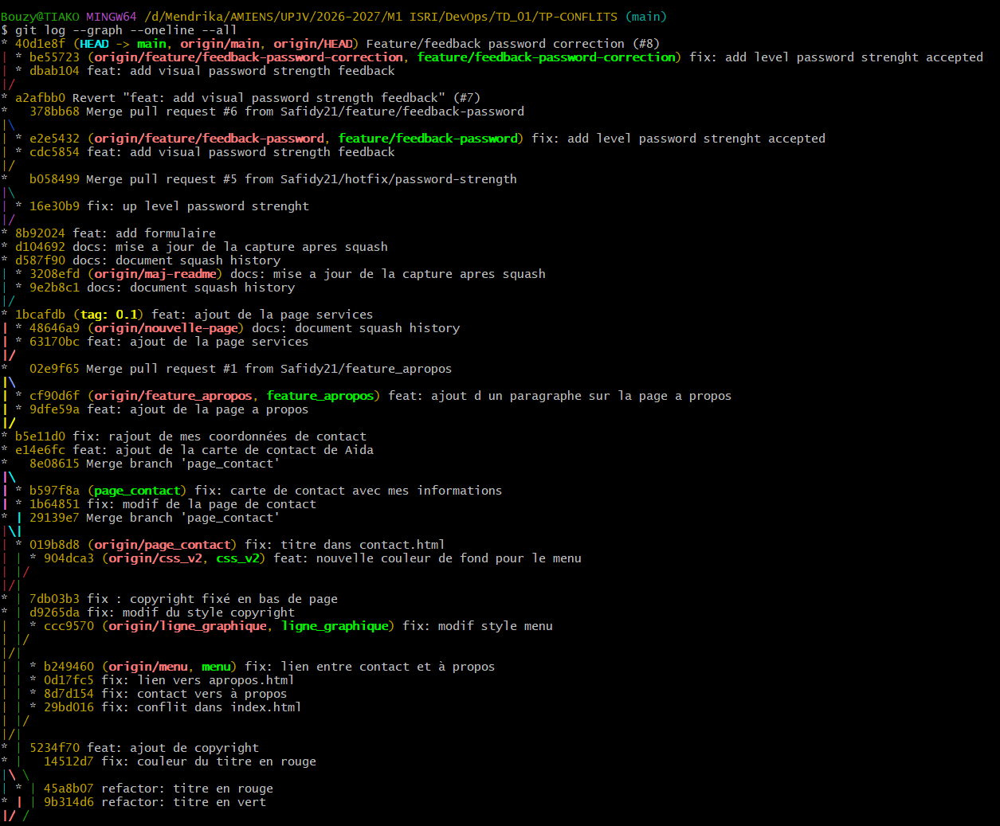

**Auteurs :**

- **Étudiante A : Safidy Mendrika TOTOZAFY**
- **Étudiante B : AIDA SY NIANG**

# TP Conflits, Rebase & Code Review

## 1. Capture du graphe Git final

Commande utilisée :

```bash
git log --graph --oneline --all
```



**Résultat :** la PR #8 a été fusionnée par **Squash and merge**. Le commit final `40d1e8f` regroupe les deux commits de la fonctionnalité et possède un seul parent : `a2afbb0`.

La PR #6 avait initialement été fusionnée par une fusion classique. Ses changements ont été annulés via la PR #7, puis réappliqués sur une nouvelle branche et intégrés par squash via la PR #8. L’ancienne fusion et son annulation restent visibles : nous avons conservé l’historique partagé. L’option `--all` affiche également les commits des branches encore présentes.

## 2. Réponses aux questions

### Q1. Quelle est la différence entre `git push --force` et `git push --force-with-lease` ? Pourquoi privilégier la seconde en équipe ?

`git push --force` permet de remplacer l’historique de la branche distante sans vérifier qu’elle correspond encore à l’état attendu. Il risque donc d’écraser des commits ajoutés par un collègue.

`git push --force-with-lease` autorise cette réécriture uniquement si la branche distante pointe toujours sur le commit attendu. Sans valeur explicite, Git utilise la référence de suivi locale. Si quelqu’un a poussé une modification depuis cet état connu, le push est refusé.

Cette vérification est essentielle en équipe après un rebase ou un squash, car elle réduit le risque d’écraser un travail concurrent. Elle suppose néanmoins que la référence attendue représente bien l’état examiné ; un fetch automatique peut actualiser cette référence sans revue des nouveaux commits.

### Q2. Pourquoi privilégier `git rebase` plutôt que `git merge` pour maintenir une branche de fonctionnalité à jour ?

Le rebase rejoue les commits de la fonctionnalité sur la dernière version de `main`. Il maintient un historique linéaire et évite d’ajouter un commit de fusion à chaque mise à jour. Cela facilite la lecture de l’historique, la revue et la recherche de l’origine d’un problème.

Dans notre TP, il a permis d’intégrer le hotfix et de résoudre le conflit avant la fusion de la fonctionnalité.

Le rebase change toutefois les identifiants des commits : sa réécriture doit être coordonnée si la branche est utilisée par plusieurs personnes. Le merge reste adapté lorsqu’il faut préserver l’historique partagé.

### Q3. Quel est l’intérêt d’imposer un squash avant la fusion d’une Pull Request dans un pipeline CI/CD ?

Le squash regroupe les commits intermédiaires en un seul commit représentant un changement cohérent. Les commits temporaires, comme `wip`, ne surchargent donc pas l’historique principal.

Cela facilite la traçabilité entre une PR et une version livrée, ainsi que l’annulation d’une fonctionnalité avec un revert du commit regroupé.

Le squash ne remplace ni la revue de code ni les tests : la version fusionnée doit être validée par le pipeline. Il ne réduit pas automatiquement le nombre d’exécutions CI, qui dépend de la configuration des déclencheurs.
